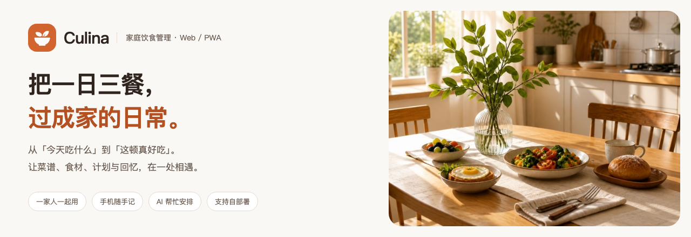
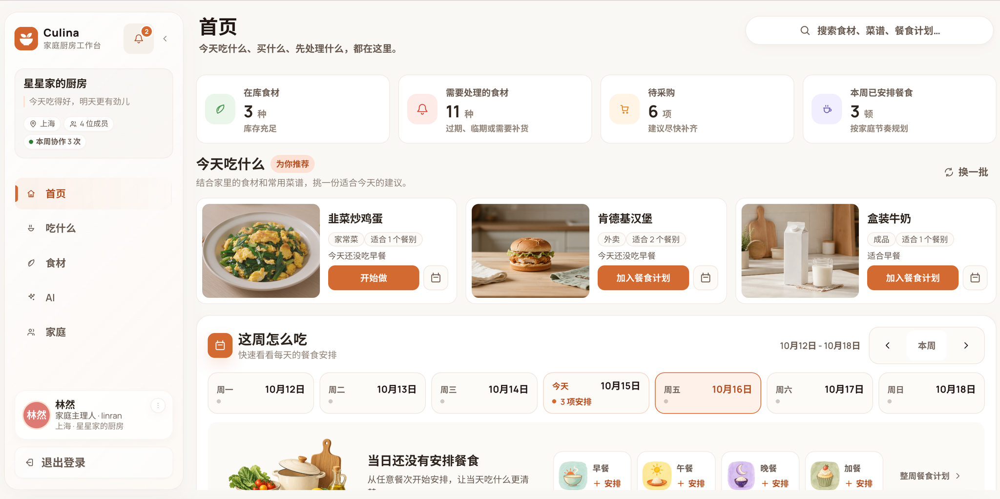
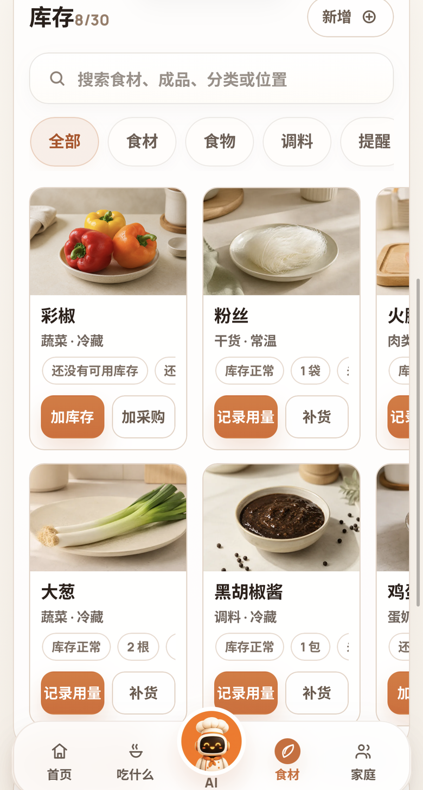
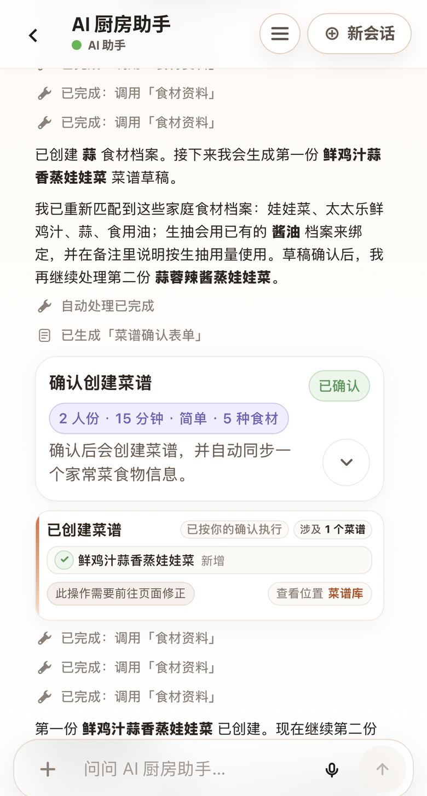

<p align="center">
  
</p>

<p align="center">
  <strong>今天吃什么，冰箱还剩什么，这周怎么买——一家人的饮食日常，一处照料。</strong>
</p>

<p align="center">
  <a href="#功能亮点">功能亮点</a> ·
  <a href="#界面预览">界面预览</a> ·
  <a href="#快速启动">快速启动</a> ·
  <a href="#本地开发">本地开发</a> ·
  <a href="#开发与贡献">开发与贡献</a>
</p>

# Culina

Culina 是面向中国家庭的移动优先饮食管理 Web / PWA。把常做的菜、爱吃的食物、冰箱里的库存、待买的清单和每一餐的照片放在一起，再让 AI 结合家里的实际情况，帮你想菜单、整理采购、安排下一餐。

**手机随手记，桌面慢慢整理；家人一起用，也可以部署在自己的服务器上。**

## 功能亮点

| 日常的小问题 | Culina 帮你做什么 |
| --- | --- |
| 🍳 **今天吃什么？** | 收藏喜欢的食物，保存菜谱与做法，查看推荐，把想吃的安排进一周餐食计划。 |
| 🥬 **冰箱里还有什么？** | 按常温、冷藏、冷冻管理库存，查看批次、余量与临期提醒，通过盘点核对实际存量。 |
| 🛒 **还需要买什么？** | 维护家庭购物清单，买齐后确认入库，让采购和库存接起来。 |
| 📷 **这顿吃得怎么样？** | 记录餐次、食物与一起吃饭的人，补充照片、评价和备注，留下可以回看的家庭饮食记忆。 |
| 🏡 **家里谁在打理？** | 家庭主理人（Owner）与成员（Member）分工协作，重要操作保留操作者与家庭动态。 |
| ✨ **AI 能帮什么忙？** | AI 结合家庭食物、菜谱、库存与历史记录提供建议，生成可检查的业务草稿；按配置支持图片、语音与实时语音。 |

从「冰箱里有番茄和鸡蛋」到「今晚做番茄炒蛋」，再到采购、做饭、记下一餐，相关信息都能在同一个家庭空间里找到。

## 界面预览

### 大屏安排，一眼看清家里的日常

从今日推荐到每周安排，先看家里有什么，再决定下一餐吃什么。

[](docs/screenshots/desktop-home.png)

### 随手打开，厨房里也能轻松用

**今天吃什么 · 把喜欢的菜收进食物库**

首页推荐带来一点灵感，食物库留下常做的家常菜；看中一道，就能开始做。

<p align="center">
  <a href="docs/screenshots/mobile-home.png"></a>
  <a href="docs/screenshots/mobile-foods.png"></a>
</p>

**家里还有什么 · 让 AI 帮忙整理做法**

库存卡片串起余量、补货和采购；AI 结合家庭食材整理菜谱，确认与执行结果都能看清。

<p align="center">
  <a href="docs/screenshots/mobile-ingredients.png"></a>
  <a href="docs/screenshots/mobile-ai.png"></a>
</p>

## AI 帮忙，决定有据可查

可以从一句具体的话开始：

> 「看看家里的库存，帮我安排两天晚饭。」<br>
> 「把缺少的食材整理成购物清单。」<br>
> 「把番茄炒蛋加入收藏，下次安排晚饭时方便找到。」

AI 的业务写入遵循同一条路径：

```text
读取获准的家庭上下文 → 生成建议或草稿 → 服务端提交校验 → 写入业务记录
```

- **需要确认的操作，等你决定。** 草稿、待审批和执行结果分开展示，不提前显示为已完成。
- **允许自动执行的操作，由服务端把关。** 只有命中已开启的策略、动作白名单、权限与版本等条件时才提交，否则转为人工确认。模型不能直接调用正式写入工具。
- **支持撤销的操作，保留恢复入口。** 能否撤销以及截止时间以服务端返回的结果为准。
- **服务和用量由家庭管理。** 主理人可以配置模型服务、验证能力与价格，并查看模型用量、预算和提醒；对话支持个人与家庭共享空间。

AI 是可选增强：食物、菜谱、库存、购物清单与餐食的手动管理不依赖模型服务。文字、图片生成、语音和语义检索等能力取决于所配置的 Provider 与模型支持。

## 快速启动

推荐先使用 **Docker Compose** 体验完整系统。准备 Git、Docker 和 Compose 插件，然后执行：

```bash
git clone https://github.com/novisfff/Culina.git
cd Culina
cp deploy/.env.example deploy/.env

# 按需编辑 deploy/.env 后启动
docker compose --env-file deploy/.env -f deploy/docker-compose.yml up -d --build
```

服务就绪后访问 **[http://localhost:8080](http://localhost:8080)**，使用 `deploy/.env` 中的 `INITIAL_ADMIN_USERNAME` / `INITIAL_ADMIN_PASSWORD` 登录。首次启动且数据库中没有用户时，系统会创建初始家庭和 Owner；已有数据不会被覆盖。

完整编排包括 **MySQL、MinIO、Qdrant、FastAPI 后端和 nginx 前端**。首次构建需要下载依赖并构建 MinIO，耗时取决于网络与构建缓存。

<details>
<summary><strong>启用 AI、查看日志与部署配置</strong></summary>

**启用 AI**：以 Owner 身份进入「家庭 → AI 服务」，添加服务商（Provider）、配置模型能力与价格，验证后发布。旧版 Provider `.env` 配置不会自动导入。向量检索还需要可用的 embedding 模型与已发布的搜索配置；仅启动 Qdrant 不会自动启用该能力。

**查看日志与停止服务**：

```bash
docker compose --env-file deploy/.env -f deploy/docker-compose.yml logs -f
docker compose --env-file deploy/.env -f deploy/docker-compose.yml down
```

停止命令保留命名卷。备份时应覆盖 MySQL、MinIO、Qdrant 以及保存本地模型凭据 keyring 的 `culina_backend_secrets` 卷。

**公开部署**：示例默认值用于本地体验。生产环境应设置 `ENVIRONMENT`、HTTPS 的 `FRONTEND_ORIGIN`，更换 JWT、管理员、数据库与 MinIO 凭据，启用 `MODEL_USAGE_REQUIRED`，并通过部署 Secret 配置模型凭据与用量回执 keyring。变量说明见 [`deploy/.env.example`](deploy/.env.example)，完整编排及升级说明见 [部署指南](deploy/README.md)。

</details>

## 本地开发

建议使用 **Node.js 22、Python 3.12、Docker Compose**。前后端分别启动，数据库与对象存储通过容器运行。

### 1. 安装依赖并准备配置

```bash
npm run frontend:install
npm run backend:venv
cp frontend/.env.example frontend/.env
cp backend/.env.example backend/.env
```

前端示例将 `VITE_API_BASE_URL` 留空，开发请求由 Vite 代理到 `http://127.0.0.1:8010`。后端变量说明见 [`backend/.env.example`](backend/.env.example)；若已调整容器中的数据库或 MinIO 凭据，也要同步本地后端配置。

### 2. 启动基础设施并迁移数据库

```bash
npm run db:up

# 后端示例默认使用 Qdrant；db:up 仅启动 MySQL 和 MinIO
docker compose -f deploy/docker-compose.yml up -d qdrant

# 等待 MySQL 就绪后执行
npm run backend:init-db
npm run backend:migrate
```

不使用向量检索时，可在 `backend/.env` 设置 `SEARCH_VECTOR_BACKEND=disabled` 并跳过 Qdrant。家庭业务数据仍存储在 MySQL 中。

### 3. 分别启动前后端

```bash
# 终端一
npm run backend:dev
```

```bash
# 终端二
npm run dev
```

| 服务 | 本地地址 |
| --- | --- |
| 前端 | [http://localhost:5173](http://localhost:5173) |
| 后端 API 文档 | [http://127.0.0.1:8010/docs](http://127.0.0.1:8010/docs) |
| 健康检查 | [http://127.0.0.1:8010/api/health](http://127.0.0.1:8010/api/health) |
| MinIO 控制台 | [http://localhost:9001](http://localhost:9001) |
| Qdrant（启用时） | [http://localhost:6333/dashboard](http://localhost:6333/dashboard) |

首次启动后使用 `backend/.env` 中的初始管理员账号登录。手机可通过支持的浏览器添加到主屏幕使用；PWA 安装与麦克风等能力需要 HTTPS 或 localhost 安全上下文，业务数据与 AI 请求仍需联网。

<details>
<summary><strong>模型凭据与媒体存储说明</strong></summary>

- 本地环境首次运行会在 `backend/storage/secrets/` 生成并持久保存模型凭据 keyring；Compose 将其保存到独立命名卷。已有加密凭据但 keyring 丢失时，后端会拒绝启动。非本地环境必须由 Secret 系统注入 `FAMILY_MODEL_CREDENTIAL_ACTIVE_KEY_ID` 与 `FAMILY_MODEL_CREDENTIAL_KEYS_JSON`。
- Provider 地址默认要求公网 HTTPS / WSS；私网服务需要显式配置允许列表。不要将 API Key 写进前端或提交到 Git。
- MinIO bucket 保持私有，浏览器通过后端签发的短时 `/api/media/{media_id}/content` 链接读取图片；nginx 不直接代理 `/media` 到 MinIO。
- 上传照片与 AI 生成图复用统一媒体流程，生成图不会覆盖用户原图。

</details>

## 技术与结构

| 层次 | 技术 |
| --- | --- |
| 界面 | React 18 · TypeScript · Vite · TanStack Query · PWA |
| 服务 | FastAPI · Pydantic · SQLAlchemy 2 · Alembic |
| 数据与搜索 | MySQL 8.4 · Qdrant |
| 图片与部署 | MinIO · Docker Compose · nginx |
| 验证 | Vitest · Testing Library · Playwright · pytest |
| AI | Skill / Tool catalog · Orchestrator / Runner · 草稿审批与服务端提交策略 |

```text
Culina/
├── frontend/
│   ├── src/app/          # 应用组合与跨工作区协调
│   ├── src/features/     # 业务功能与工作区
│   ├── src/components/   # 共享组件、ui-kit 与既有业务组件
│   └── e2e/              # 浏览器关键路径与截图回归
├── backend/
│   ├── app/              # API、权限、服务、数据访问与 AI Runtime
│   ├── alembic/          # 数据库迁移
│   └── tests/            # 领域、契约与集成测试
├── deploy/               # Compose、环境变量示例与部署验证
├── docs/                 # 开发规范、设计说明与项目截图
└── AGENTS.md             # AI 辅助开发导航与修改边界
```

## 开发与贡献

从你要修改的业务域开始，先阅读对应规范，再运行与改动相关的检查。

| 文档 | 用途 |
| --- | --- |
| [前端代码规范](docs/frontend-code-standards.md) | 组件职责、状态、缓存、API 与验证 |
| [前端视觉规范](.agents/skills/frontend-ui-style/SKILL.md) | 色板、组件样式、移动端与响应式规则 |
| [后端代码规范](docs/backend-code-standards.md) | 分层、家庭权限、事务与迁移 |
| [AI 助手规范](docs/ai-assistant-standards.md) | Skill、Tool、Runtime、草稿与提交边界 |
| [浏览器测试说明](frontend/e2e/README.md) | P0 关键路径、截图基线与失败证据 |
| [设计与专题记录](docs/plans/README.md) | 架构说明、专项计划与实现背景 |
| [AI 辅助开发指南](AGENTS.md) | 仓库导航、任务范围与交付要求 |

<details>
<summary><strong>常用开发与验证命令</strong></summary>

所有命令均从仓库根目录执行。按影响范围选择定向检查，不必为文档或小修运行全部门禁。

| 命令 | 用途 |
| --- | --- |
| `npm test -- src/path/example.test.ts` | 定向前端 Vitest（替换为实际测试路径） |
| `npm run frontend:typecheck` | 前端 TypeScript 检查 |
| `npm run frontend:quality` | TypeScript、Vitest 与样式 token 漂移报告 |
| `npm run frontend:build` | 类型检查、生产构建与 bundle 预算检查 |
| `npm run frontend:e2e:p0` | Playwright 关键路径与截图回归，需先构建前端 |
| `npm --prefix frontend run check:style-tokens` | 样式 token 漂移检查，结果仍需人工审阅 |
| `npm run backend:test:service` | 后端领域服务分类测试 |
| `npm run backend:test:ai` | AI 分类测试 |
| `npm run backend:test:ai-evals` | AI 评估场景测试 |
| `npm run backend:test:search` | 搜索分类测试 |
| `npm run backend:quality` | Python 语法编译检查与全量 pytest |
| `npm run backend:migrate` | 执行 Alembic 迁移 |
| `git diff --check` | 检查补丁中的空白问题 |

首次运行浏览器测试时安装 Chromium：

```bash
cd frontend
npx playwright install chromium
```

测试工具各有边界：`backend:typecheck` 当前使用 `compileall`，不是静态类型分析；浏览器 P0 使用 API mock，不替代真实数据库、权限、并发与部署验收。

</details>

家庭数据始终按 `family_id` 隔离；用户可见写入保留操作者与活动日志；持久化 schema 变更新增迁移；AI 正式写入经过服务端提交校验。请勿提交 `.env`、密钥或真实家庭调试数据。

---

<p align="center">好好吃饭，认真生活。让每一餐，都更像家的味道。</p>

<p align="center">交流社区：<a href="https://linux.do/">LINUX DO</a></p>
